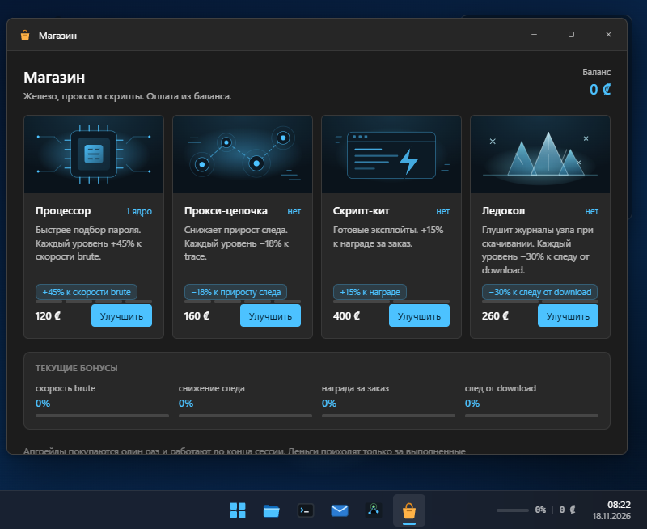

# ЗАРЯ OS — хакер-симулятор в оболочке Windows 11

[](https://yungspiderq.github.io/zarya-os/)
[](CHANGELOG.md)
[](LICENSE)

Маленькая «операционная система» на HTML + CSS + чистом JavaScript.
Никаких сборок, npm и интернета: открой `index.html` двойным кликом (или `start.cmd`).

**Играть онлайн:** https://yungspiderq.github.io/zarya-os/


<p align="center">
  
  
</p>

## Новое в 1.3 «Апгрейд»

Симулятор виртуального ПК с апгрейдами CPU, GPU и ОЗУ, а также две мини-игры в «Аркаде». Подробности: [примечания к версии](RELEASE_NOTES_1.3.md).

## Что внутри

Оболочка в духе Windows 11: экран загрузки, экран входа, рабочий стол,
меню «Пуск» с поиском и рекомендациями, панель задач с закреплёнными
приложениями, быстрые настройки, тёмная и светлая темы, акценты, обои,
перетаскивание и снап окон к краям, контекстные меню, диалоги.
Все иконки — SVG (никаких эмодзи).

На рабочем столе — виджет «Сводка»: баланс, след, взломано узлов, закрыто
контрактов и живой радар. Клик по нему открывает карту сети.

Игра:

| Приложение | Зачем |
|---|---|
| Терминал | Взлом: `scan`, `connect`, `brute`, `login`, `ls`, `cat`, `download`, `decrypt`, `wipe`, `inject`, `hide`, `contracts` |
| Почта | Заказы от «relay» и контракты с биржи: тип, награда, цель, подсказка |
| Сеть | Карта узлов: роль, защита, порты, статус взлома, сброс следа |
| Проводник | Локальные файлы, добыча в `~/loot/<ip>` |
| Заметки | Свои записи и пароли |
| Магазин | Реальные модели CPU, GPU, ОЗУ, прокси-цепочка, скрипт-кит и ледокол |
| Мой ПК | Покупка комплектующих, игровая оценка FPS и задержки |
| Аркада | Змейка и тест реакции: заработок аркадных кредитов |
| Настройки | Тема, акцент, обои, эффекты, сброс прогресса |
| О системе | Статистика сессии |

## Виртуальное железо и Аркада

В приложении **Мой ПК** можно улучшать процессор (Intel Celeron → Core i3 → Ryzen 5 → Core i5 → Ryzen 7), видеокарту (Intel UHD → GT 1030 → RX 580 → GTX 1660 SUPER → RTX 3060) и оперативную память (2–32 ГБ DDR4).

- **CPU** покупается за обычные ₡ из контрактов в магазине, продолжает ускорять игровую команду `brute` и уменьшает задержку реакции.
- **GPU** и **ОЗУ** покупаются за отдельные *аркадные кредиты*, которые выдаются за результаты мини-игр. Это отдельная валюта, чтобы не затрагивать старую систему денежных наград и сохранений.
- **Аркада** содержит «Пиксельную змейку» (стрелки/WASD и экранные кнопки) и «Тест реакции» (клик/пробел). Симулируемые FPS и задержка зависят от железа. Награда ограничена 100 кредитами и выплачивается не чаще раза в минуту для каждой игры.
- Слабое железо **не тормозит настоящий компьютер**: ограничена лишь игровая отрисовка Аркады. Реальные модели используются как игровые названия; производительность и цены не являются настоящими бенчмарками и ценами магазинов.

Данные мини-игр сохраняются в `zarya.hardware.v1` в localStorage и сбрасываются вместе с прогрессом через настройки.

## Типы заказов

Заказы отличаются не только адресом — у каждого свой тип и своё действие:

| Тип | Что нужно | Команда |
|---|---|---|
| данные | скачать файл с узла | `download` |
| разведка | прочитать файл на месте | `cat` |
| скрытность | прочитать файл, пока след ниже порога | `cat` + `hide` |
| зачистка | уничтожить файл на узле | `wipe` |
| имплант | оставить на узле свою закладку | `inject` |
| дешифровка | вскрыть зашифрованный контейнер | `decrypt` |

В почте у каждого письма видны тип, награда, сложность узла, цель и условие.
В терминале `missions` показывает активные заказы, `contracts` — все побочные.

## Как играть

1. Открой **Почту** и прими первый заказ.
2. В **Терминале**: `scan 10.0.0.7` → `connect 10.0.0.7` → `brute` → `download grades.db`.
3. Заказ закроется сам, деньги придут на баланс.
4. Каждое действие на чужом узле поднимает **след**. 100% — тебя ловят:
   штраф 35% баланса и −1 репутация. `hide` сбрасывает след за 80 ₡
   (кнопка есть и в приложении **Сеть**).
5. Апгрейды в **Магазине** ускоряют подбор пароля, снижают прирост следа
   и глушат журналы узла при скачивании.

## Побочные контракты

Кроме основной цепочки из пяти заказов в почте лежат семь контрактов с биржи.
Они доступны сразу, не блокируют сюжет и не мешают основной линии:

| Контракт | Узел | Задача | Награда |
|---|---|---|---|
| горячий Wi-Fi | 192.168.88.14 · Кофейня FreeWiFi | скачать `wifi.log` | 90 ₡ |
| камера в кофейне | 192.168.88.14 · Кофейня FreeWiFi | прочитать `cam_feed.txt` | 130 ₡ |
| абоненты «Волны» | 77.88.44.19 · Оператор «Волна» | скачать `subscribers.csv` | 700 ₡ |
| ни одного следа | 10.0.0.7 · Школьный сервер | прочитать `passwords.txt` при следе ≤ 20% | 210 ₡ |
| концы в воду | 45.13.88.2 · Тёмный рынок | уничтожить `mirror.log` | 340 ₡ |
| свой человек | 91.204.17.55 · Дата-центр «Север» | поставить имплант `zarya.svc` | 520 ₡ |
| закрытый кошелёк | 45.13.88.2 · Тёмный рынок | расшифровать `wallet.dat` | 480 ₡ |

- **ни одного следа** — если след к моменту чтения выше 20%, заказ не засчитывается. Сначала `hide`.
- **концы в воду** — файл исчезает с узла, в `ls` его больше нет, скачать нельзя.
- **свой человек** — имплант остаётся на узле и виден в `ls` как активный.
- **закрытый кошелёк** — `cat` и `download` на шифр не сработают, нужен `decrypt`.

В терминале их список выводит команда `contracts`. Всего в сети 7 узлов:
5 сюжетных и 2 дополнительных.

Все адреса, пароли и организации вымышлены. Это игра, а не инструкция.

## Файлы

```
index.html          разметка оболочки
css/style.css       оформление Windows 11
js/icons.js         SVG-иконки
js/fs.js            виртуальная файловая система (localStorage)
js/settings.js      тема, акцент, обои
js/ui.js            тосты, диалоги, контекстные меню
js/wm.js            оконный менеджер, снап
js/game.js          сеть, взлом, заказы, деньги, след
js/apps.js          приложения
js/hardware.js      виртуальное железо, аркадная валюта и сохранения
js/arcade.js        приложение «Мой ПК» и мини-игры
css/arcade.css      оформление новых приложений
js/main.js          загрузка, вход, «Пуск», панель задач
```

Прогресс и настройки хранятся в `localStorage` браузера.
Сброс: Настройки → Игра → «Начать заново».
