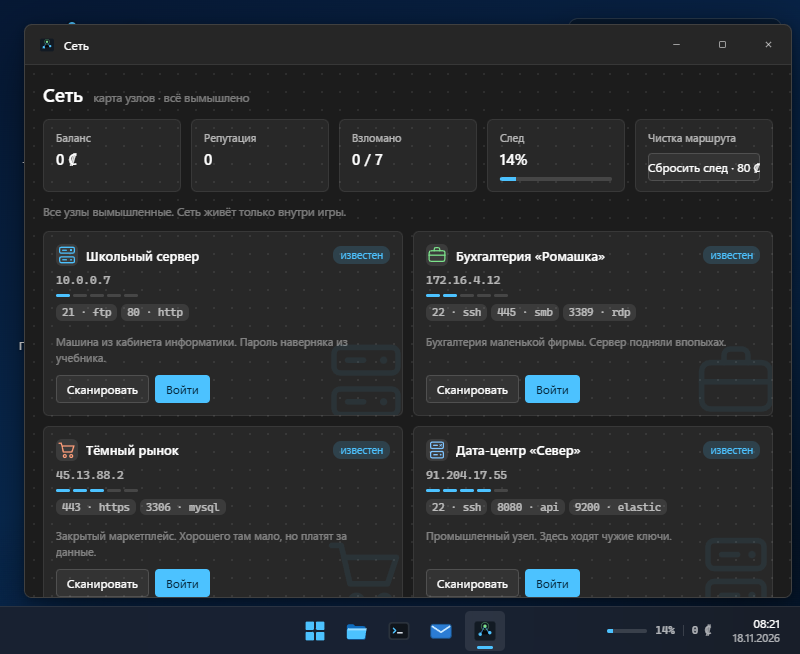

# ЗАРЯ OS — хакер-симулятор в оболочке Windows 11

[](https://yungspiderq.github.io/zarya-os/)
[](CHANGELOG.md)
[](LICENSE)

Маленькая «операционная система» на HTML + CSS + чистом JavaScript.
Никаких сборок, npm и интернета: открой `index.html` двойным кликом (или `start.cmd`).

**Играть онлайн:** https://yungspiderq.github.io/zarya-os/


<p align="center">
  
  
</p>

## Новое в 1.5 «Железная мастерская»

Три новых категории товаров в **Магазине комплектующих**: материнские платы (LGA1200/DDR4), блоки питания (300–750 Вт) и SATA/M.2 накопители (HDD, SATA SSD, NVMe SSD). После покупки детали лежат в инвентаре. Мощность блока питания и наличие разъёма M.2 теперь влияют на совместимость железа.

- **Материнские платы:** ASRock H410M-HDV, MSI B460M PRO-VDH WIFI, ASUS TUF GAMING B560M-PLUS, MSI MAG Z490 TOMAHAWK.
- **Блоки питания:** OEM 300W, Corsair CV450, be quiet! System Power 10 550W, Corsair CX650, Seasonic FOCUS GX-750.
- **Накопители:** WD Blue HDD, Kingston A400, Samsung 870 EVO, WD Blue SN570, Samsung 970 EVO Plus.
- **Новая мини-игра «Монтаж SSD»:** выключи виртуальный ПК, найди SATA или M.2, выбери накопитель, установи, закрепи и включи.
- **Диагностика ПК:** примерное игровое потребление, запас мощности блока питания, скорость диска и время загрузки ЗАРЯ OS. Все оценки условные, без физического замедления компьютера.
- **Сохранения 1.4 совместимы:** существующие CPU, GPU, ОЗУ, история и аркадные рекорды остаются на месте. Старое железо возвращается в инвентарь после замены.

**Новое в 1.4:**

Теперь это **магазин отдельных комплектующих**, а не линейные улучшения. Процессоры, видеокарты и модули ОЗУ выбираются по моделям. Покупка добавляет товар в инвентарь — для повышения производительности деталь нужно вручную установить. GPU и ОЗУ устанавливаются из «Моего ПК», а замена процессора проходит через **новую шестишаговую мини-игру «Мастерская CPU»**.

Снять кулер → открыть фиксатор → извлечь старый CPU → совместить золотой угол нового процессора и вставить → закрыть фиксатор → поставить кулер. Только после последнего шага новый CPU начинает влиять на производительность. Старый CPU возвращается в инвентарь; прерванная замена ничего не портит.

Все доступные процессоры рассчитаны на сокет **LGA1200**, память — DDR4. Это упрощённая симуляция, а не инструкция по физической сборке. Аркадные кредиты и деньги контрактов можно комбинировать при покупке деталей. Существующие сохранения 1.3 переносятся автоматически.

**Новое в 1.3:**

Симулятор виртуального ПК с апгрейдами CPU, GPU и ОЗУ, а также две мини-игры в «Аркаде». Подробности: [примечания к версии](RELEASE_NOTES_1.3.md).

## Что внутри

Оболочка в духе Windows 11: экран загрузки, экран входа, рабочий стол,
меню «Пуск» с поиском и рекомендациями, панель задач с закреплёнными
приложениями, быстрые настройки, тёмная и светлая темы, акценты, обои,
перетаскивание и снап окон к краям, контекстные меню, диалоги.
Все иконки — SVG (никаких эмодзи).

На рабочем столе — виджет «Сводка»: баланс, след, взломано узлов, закрыто
контрактов и живой радар. Клик по нему открывает карту сети.

Игра:

| Приложение | Зачем |
|---|---|
| Терминал | Взлом: `scan`, `connect`, `brute`, `login`, `ls`, `cat`, `download`, `decrypt`, `wipe`, `inject`, `hide`, `contracts` |
| Почта | Заказы от «relay» и контракты с биржи: тип, награда, цель, подсказка |
| Сеть | Карта узлов: роль, защита, порты, статус взлома, сброс следа |
| Проводник | Локальные файлы, добыча в `~/loot/<ip>` |
| Заметки | Свои записи и пароли |
| Магазин | Модели CPU, GPU, RAM, материнские платы, БП, SSD/HDD и программное обеспечение |
| Мой ПК | Установленные CPU/GPU/ОЗУ, инвентарь, замена видеокарты и ОЗУ |
| Мастерская CPU | Мини-игра замены процессора на материнской плате |
| Монтаж SSD | Установка SATA и M.2 накопителей в виртуальный ПК |
| Аркада | Змейка и тест реакции: заработок аркадных кредитов |
| Настройки | Тема, акцент, обои, эффекты, сброс прогресса |
| О системе | Статистика сессии |

## Виртуальный ПК и Аркада

В **Магазине комплектующих** представлены реальные модели процессоров Intel Celeron/Core для LGA1200, видеокарт Intel/NVIDIA/AMD и оперативной памяти DDR4. Каждая деталь приобретается отдельно и до установки хранится в инвентаре. После замены старая деталь возвращается в инвентарь (кроме встроенной графики).

- **CPU** можно заменить только в мини-игре **«Мастерская CPU»**. Закончи все 6 шагов, чтобы новый процессор влиял на скорость команды `brute`.
- **GPU** и **ОЗУ** устанавливаются вручную из приложения **«Мой ПК»**. Они влияют на FPS и задержку реакции в Аркаде.
- **Оплата** комплектующих: сначала используются аркадные кредиты, остаток списывается со счёта контрактов (₡).
- **Аркада** содержит «Пиксельную змейку» (стрелки/WASD и экранные кнопки) и «Тест реакции» (клик/пробел). За результат начисляется до 100 аркадных кредитов не чаще раза в минуту для каждой игры.
- **Игровые FPS и цены условные**: слабое железо не тормозит настоящий компьютер и не ухудшает работу браузера.

Комплектующие, инвентарь и рекорды сохраняются в `zarya.components.v2` в localStorage. Данные из `zarya.hardware.v1` переносятся автоматически при первом запуске версии 1.4.

## Типы заказов

Заказы отличаются не только адресом — у каждого свой тип и своё действие:

| Тип | Что нужно | Команда |
|---|---|---|
| данные | скачать файл с узла | `download` |
| разведка | прочитать файл на месте | `cat` |
| скрытность | прочитать файл, пока след ниже порога | `cat` + `hide` |
| зачистка | уничтожить файл на узле | `wipe` |
| имплант | оставить на узле свою закладку | `inject` |
| дешифровка | вскрыть зашифрованный контейнер | `decrypt` |

В почте у каждого письма видны тип, награда, сложность узла, цель и условие.
В терминале `missions` показывает активные заказы, `contracts` — все побочные.

## Как играть

1. Открой **Почту** и прими первый заказ.
2. В **Терминале**: `scan 10.0.0.7` → `connect 10.0.0.7` → `brute` → `download grades.db`.
3. Заказ закроется сам, деньги придут на баланс.
4. Каждое действие на чужом узле поднимает **след**. 100% — тебя ловят:
   штраф 35% баланса и −1 репутация. `hide` сбрасывает след за 80 ₡
   (кнопка есть и в приложении **Сеть**).
5. Установленный **CPU** ускоряет подбор пароля; вкладка «Программы» в **Магазине** снижает прирост следа
   и глушит журналы узла при скачивании.

## Побочные контракты

Кроме основной цепочки из пяти заказов в почте лежат семь контрактов с биржи.
Они доступны сразу, не блокируют сюжет и не мешают основной линии:

| Контракт | Узел | Задача | Награда |
|---|---|---|---|
| горячий Wi-Fi | 192.168.88.14 · Кофейня FreeWiFi | скачать `wifi.log` | 90 ₡ |
| камера в кофейне | 192.168.88.14 · Кофейня FreeWiFi | прочитать `cam_feed.txt` | 130 ₡ |
| абоненты «Волны» | 77.88.44.19 · Оператор «Волна» | скачать `subscribers.csv` | 700 ₡ |
| ни одного следа | 10.0.0.7 · Школьный сервер | прочитать `passwords.txt` при следе ≤ 20% | 210 ₡ |
| концы в воду | 45.13.88.2 · Тёмный рынок | уничтожить `mirror.log` | 340 ₡ |
| свой человек | 91.204.17.55 · Дата-центр «Север» | поставить имплант `zarya.svc` | 520 ₡ |
| закрытый кошелёк | 45.13.88.2 · Тёмный рынок | расшифровать `wallet.dat` | 480 ₡ |

- **ни одного следа** — если след к моменту чтения выше 20%, заказ не засчитывается. Сначала `hide`.
- **концы в воду** — файл исчезает с узла, в `ls` его больше нет, скачать нельзя.
- **свой человек** — имплант остаётся на узле и виден в `ls` как активный.
- **закрытый кошелёк** — `cat` и `download` на шифр не сработают, нужен `decrypt`.

В терминале их список выводит команда `contracts`. Всего в сети 7 узлов:
5 сюжетных и 2 дополнительных.

Все адреса, пароли и организации вымышлены. Это игра, а не инструкция.

## Файлы

```
index.html          разметка оболочки
css/style.css       оформление Windows 11
js/icons.js         SVG-иконки
js/fs.js            виртуальная файловая система (localStorage)
js/settings.js      тема, акцент, обои
js/ui.js            тосты, диалоги, контекстные меню
js/wm.js            оконный менеджер, снап
js/game.js          сеть, взлом, заказы, деньги, след
js/apps.js          приложения
js/hardware.js      виртуальное железо, аркадная валюта и сохранения
js/arcade.js        аркадные мини-игры
js/components.js    магазин комплектующих, инвентарь и мастерская CPU
js/drive-lab.js     мини-игра «Монтаж SSD»
css/drive-lab.css   стили диагностики и мастерской SSD
css/components.css  оформление компонентов и мастерской
css/arcade.css      оформление новых приложений
js/main.js          загрузка, вход, «Пуск», панель задач
```

Прогресс и настройки хранятся в `localStorage` браузера.
Сброс: Настройки → Игра → «Начать заново».
