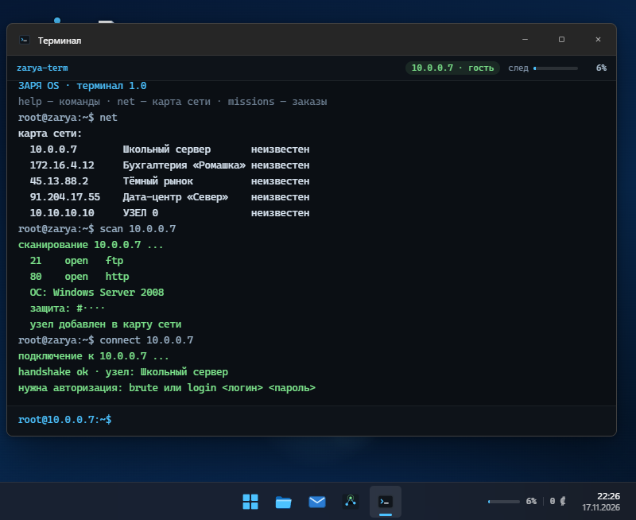

# ЗАРЯ OS — хакер-симулятор в оболочке Windows 11

[](https://yungspiderq.github.io/zarya-os/)
[](CHANGELOG.md)
[](LICENSE)

Маленькая «операционная система» на HTML + CSS + чистом JavaScript.
Никаких сборок, npm и интернета: открой `index.html` двойным кликом (или `start.cmd`).

**Играть онлайн:** https://yungspiderq.github.io/zarya-os/



<p align="center">
  
  
</p>

## Новое в 2.2 «Операции и цифровые следы»

Новая кампания **«Операционный центр»** — восемь связанных расследований внутри полностью вымышленной сети. В каждом задании нужно исследовать журналы шести виртуальных систем, находить общий идентификатор события, определять истинную цепочку из трёх сегментов и выбирать подходящее заключение.

Построение вывода требует как минимум четыре изученных источника. Лимиты на время, риск и ошибки заставляют планировать действия. Неверный отчёт не раскрывает ответ. Каждое завершённое расследование оплачивается один раз, дальнейшие задания открываются постепенно.

Режим доступен как самостоятельное приложение и через встроенный терминал. Никаких обращений к реальным серверам или сетевым адресам нет. Все задачи — упражнения на внимательность, корреляцию данных и принятие решений.

**Сохранения версии 2.1 сохраняются.** Повторного сброса прогресса нет.

## Новое в 2.1 «Профессиональная мастерская»

В версии **2.1** компьютерная мастерская получила отдельный сложный режим **«Мастерская: Профи»**. Здесь нельзя просто нажать несколько кнопок и получить награду.

- **Клиенты с несколькими независимыми неисправностями.** В одном заказе встречаются 2–3 дефекта; нужно выбрать инструментальные тесты (MemTest, SMART, питание, термопрофиль, POST, графика, ОС, вентиляция) и сопоставить отчёты.
- **Платная диагностика и экономическое планирование.** Каждый тест расходует игровой бюджет клиента и рабочее время. Требуется найти все причины, не потратив средства, необходимые для ремонта.
- **Правильная смета.** Выбирай наборы ремонта по конкретным найденным дефектам. Неверная закупка и диагноз ведут к штрафам.
- **Инженерные сборки из семи комплектующих.** CPU, GPU, RAM, плата, БП, накопитель и кулер. Проверяются FPS, время загрузки, совместимость сокета/M.2, запас мощности БП не менее 25% и условная температура процессора.
- **Реальная для игры приёмка.** Три измерения со значениями и нормами: CPU, запас БП, ошибки памяти/диска. Отклонения требуют дополнительной регулировки и повторного теста.
- **Критические ошибки и репутация.** На заказ ограниченное число рабочих действий. Две серьёзные ошибки или превышение срока могут сорвать контракт без выплаты. Репутация падает на 11 пунктов за провал и растёт за качественную работу.
- **Постоянная очередь и сохранения.** Новые заказы появляются после выполненных; открытый контракт, смета, исследования и этап QA сохраняются.

### Сезонный сброс прогресса и защита от накрутки

**ВНИМАНИЕ: при первом запуске 2.1 весь старый игровой прогресс Zarya OS на этом устройстве/в этом браузере будет очищен.** Это одноразовый сброс сезона. Все деньги, купленные детали, история заказов, внутриигровые файлы и настройки будут сброшены. При следующих запусках версии 2.1 новый прогресс сохраняется.

- Сброс действует **на каждом клиенте при его первом открытии новой версии**. Поскольку Zarya OS не имеет сервера профилей, удалить сохранения на удалённых устройствах до их следующего запуска невозможно.
- Главный локальный кошелёк проверяется на целостность; изменение денежного баланса или записей выплат в `localStorage` без правильного локального контрольного значения приводит к сбросу подозрительного прогресса.
- За один заказ и достижение нельзя получать выплату повторно, в том числе после перезагрузки.
- **Импорт игровых денег из JSON отключён.** «Центр сохранений» продолжает экспортировать архив прогресса, но восстановить из него можно только настройки интерфейса, а не валюту, железо или достижения.
- Это **локальная базовая защита**, а не полноценный неуязвимый античит. Для надёжной защиты от пользователя, который контролирует код браузера, необходим сервер с авторитетной базой балансов и подписанными транзакциями.

Все операции ремонта и показатели тестов — вымышленные игровые механики.

## Главное обновление 2.0 «Своя компьютерная мастерская»

**Zarya OS 2.0** превращает симулятор виртуального ПК в игру о развитии собственного компьютерного бизнеса — не убирая старые приложения, заказы, сборки, магазин и Аркаду.

### «Моя компания» — новая карьера

- **Бесконечная очередь клиентов**. Три заказа доступны с самого начала; количество можно увеличить до шести. После выполнения контракта автоматически появляется новый.
- **Четыре вида работ**: диагностика с выбором причины и ремонта; сборка клиентского ПК с проверкой бюджета и совместимости; обслуживание охлаждения; последовательное тестирование оборудования.
- **Шесть рангов** от «Гаражной мастерской» до «Корпорации ЗАРЯ». Компания получает XP за каждый контракт, а ранг открывает улучшения.
- **Четыре направления развития**: дополнительные рабочие места, реклама (+8% к выплатам за уровень), диагностический сканер (подсказки) и профессиональный тестовый стенд (меньше этапов проверки). У каждого направления три уровня.
- **12 достижений** с наградами: первые клиенты, крупная мастерская, успешные диагностики, сборки и обслуживание.
- **Постоянная экономика**: за выполненные заказы начисляются обычные игровые ₡, которые можно тратить в магазине. Повторные выплаты за один контракт защищены в основном сохранении.
- **История**: последние 30 работ, ошибки, безошибочные контракты и доход компании. В приложении можно задать название мастерской.

### «Центр сохранений» — полная резервная копия

- **Экспорт в один JSON** из браузера без сервера: деньги и контракты, инвентарь и б/у детали, рабочий компьютер, компания, сервисные задания, сборки клиентов, охлаждение, игровая файловая система и настройки.
- **Импорт с проверкой**: тип и размер файла, список допустимых ключей, версия данных и синтаксис проверяются **до** записи. Восстановление требует явного подтверждения и перезагрузки приложения.
- **Защита данных**: импорт не затрагивает чужие записи браузера и пытается вернуть прежний прогресс, если запись сорвалась.
- Переход на 2.0 не сбрасывает прогресс версии 1.9 и не требует начинать игру заново.

**Важно:** все заказы, цены, бенчмарки и вычисления производительности — игровая симуляция. Внешних серверов для прогресса и резервных копий нет.

## Новое в 1.9 «Техно-барахолка»

**«Техно-барахолка»** — новое приложение для покупки и продажи подержанных комплектующих.

- **Семь ежедневных лотов** — CPU, GPU, RAM, материнская плата, БП, накопитель и кулер. Ассортимент меняется раз в сутки по UTC, одинаков для всех запусков игры в этот день. Скидки относительно цены нового железа составляют примерно 40–60%.
- **Осмотр перед покупкой:** три интерактивных отчёта о контактах, нагрузке и состоянии детали. Нужно определить, в каком тесте есть замечания. После проверки открывается процент состояния и возможность покупки.
- **Покупка:** б/у модель появляется в том же инвентаре, что и новые товары. Дубликаты нельзя покупать, купленная деталь не устанавливается автоматически.
- **Б/у состояние:** сохранённый процент состояния может немного снижать *виртуальный* FPS и отзывчивость, если изношены установленные CPU, GPU, RAM или диск.
- **Мастерская восстановления:** три этапа игрового обслуживания подержанной детали. После завершения состояние повышается до 100%, и игровой штраф за износ исчезает. Каждую б/у деталь можно восстановить один раз.
- **Продажа:** ненужные запасные платные комплектующие можно продать за часть их стоимости. Установленные и бесплатные стартовые детали защищены от случайной продажи; требуется второе подтверждение.
- **Сохранения:** б/у состояние входит в прежнее сохранение `zarya.components.v2`, а список лотов, осмотры и этапы восстановления — в `zarya.market.v1`. Предыдущие деньги, ПК, Аркада, сервисные заказы и сборки не меняются.

Все цены, состояние деталей и диагностические отчёты придуманы для игры и не отражают реальный рынок электроники.

## Новое в 1.8 «Температура под контролем»

Добавлена **система игрового охлаждения компьютера** и приложение **«Охлаждение ПК»**.

- **Пять моделей кулеров:** Intel Stock Cooler (стартовый), DeepCool AG400, ARCTIC Freezer 34 eSports DUO, be quiet! Pure Rock 2 и Noctua NH-U12S.
- **Покупка кулера:** в «Магазине комплектующих» появилась категория «Кулеры». Новый кулер попадает в инвентарь и не устанавливается автоматически.
- **Мини-игра замены:** выбрать купленный кулер, снять старый, очистить CPU, нанести виртуальную термопасту, установить и закрепить охлаждение. Старый кулер возвращается в инвентарь; прерванная работа не меняет установленный.
- **Мини-игра очистки пыли:** найти и очистить шесть участков на игровой материнской плате.
- **Игровая температура:** рассчитывается по CPU, GPU, кулеру, пыли и термопасте. При перегреве снижаются только виртуальные FPS и скорость отклика; реальный компьютер и браузер не замедляются намеренно.
- **Износ:** после пройденных бенчмарков и мини-игр пыль постепенно увеличивается, термопаста ухудшается. Уход за виртуальным ПК возвращает производительность.
- **Интеграция:** температура и пыль показываются в «Моём ПК», игровое снижение FPS отражается в Аркаде и ЗАРЯ Bench.
- **Сохранения:** вся старая игра версии 1.7 остаётся совместимой; новые данные ухода сохраняются отдельно в `zarya.cooling.v1` и сбрасываются вместе с прогрессом.

Температуры, цены и охлаждение — исключительно игровая механика. Мини-игра не является инструкцией по реальному ремонту компьютера.

## Новое в 1.7 «Сборка на заказ»

**«Сборка на заказ»** — отдельная экономика клиентских ПК: 8 контрактов с нарастающими требованиями к бюджету, скорости загрузки, игровому FPS, объёму ОЗУ, процессору и видеокарте.

- **Конфигуратор**: подбирай шесть видов комплектующих из настоящих игровых моделей: CPU, GPU, RAM, материнскую плату, блок питания и диск.
- **Бюджет клиента**: у каждой детали есть внутриигровая цена; в стоимость включены корпус и сборка (180 ₡). Дешёвые стартовые детали тоже имеют цену для заказных ПК.
- **Автоматическая проверка**: несовместимость по сокету, отсутствие M.2, слабый блок питания, превышение бюджета или нехватка FPS мешают начать сборку.
- **Мини-игра на монтажном стенде**: материнская плата → CPU/RAM → GPU/SSD → провода и БП → POST → сдача клиенту.
- **Награды**: за каждую успешную сборку выдаются ₡ на основной игровой баланс, получить их повторно нельзя.
- **Сохранения**: черновики и этап сборки сохраняются в `zarya.pc-orders.v1`. Старый личный ПК и инвентарь остаются без изменений: виртуальное железо для клиентов оплачивается из их бюджетов.

Это игровая симуляция с условными ценами и производительностью, а не реальный подбор деталей или расчёт расхода электричества.

## Новое в 1.6 «Сервисный центр»

- **Сервисный центр:** восемь сюжетных заказов от виртуальных клиентов. Нужно изучить описание и диагностические данные, определить неисправность, затем выбрать правильный ремонт. Сложные задачи открываются по мере прохождения; у каждого заказа одна выплата за успешное завершение.
- **ЗАРЯ Bench:** игровой бенчмарк с тремя тестами — «Игры», «Работа», «Накопитель». Очки, FPS, условные задержка и время загрузки рассчитываются по **фактически установленным** деталям. Рекорды сохраняются между запусками.
- **Новые способы заработать:** за сервисные заказы выдаются обычные ₡, которые можно тратить в «Магазине комплектующих».
- **Удобнее работать:** «Мой ПК» теперь прокручивается даже с длинным инвентарём; кнопки сервисного центра и бенчмарка доступны прямо из него.
- **Совместимость:** прогресс игры и железо из версии 1.5.1 сохраняются. Сервисные заказы и рекорды хранятся отдельно в `zarya.service.v1` и сбрасываются вместе с прогрессом через Настройки.

Всё происходит в браузерной игровой симуляции; никакие реальные компьютеры не тестируются и не ремонтируются.

## Исправление 1.5.1

В «Магазине комплектующих» исправлена вертикальная прокрутка: колесо мыши, прокрутка с клавиатуры и полоса прокрутки позволяют просмотреть все товары и нижние кнопки даже при небольшом размере окна. Вкладки категорий остаются видимыми во время прокрутки.

## Новое в 1.5 «Железная мастерская»

Три новых категории товаров в **Магазине комплектующих**: материнские платы (LGA1200/DDR4), блоки питания (300–750 Вт) и SATA/M.2 накопители (HDD, SATA SSD, NVMe SSD). После покупки детали лежат в инвентаре. Мощность блока питания и наличие разъёма M.2 теперь влияют на совместимость железа.

- **Материнские платы:** ASRock H410M-HDV, MSI B460M PRO-VDH WIFI, ASUS TUF GAMING B560M-PLUS, MSI MAG Z490 TOMAHAWK.
- **Блоки питания:** OEM 300W, Corsair CV450, be quiet! System Power 10 550W, Corsair CX650, Seasonic FOCUS GX-750.
- **Накопители:** WD Blue HDD, Kingston A400, Samsung 870 EVO, WD Blue SN570, Samsung 970 EVO Plus.
- **Новая мини-игра «Монтаж SSD»:** выключи виртуальный ПК, найди SATA или M.2, выбери накопитель, установи, закрепи и включи.
- **Диагностика ПК:** примерное игровое потребление, запас мощности блока питания, скорость диска и время загрузки ЗАРЯ OS. Все оценки условные, без физического замедления компьютера.
- **Сохранения 1.4 совместимы:** существующие CPU, GPU, ОЗУ, история и аркадные рекорды остаются на месте. Старое железо возвращается в инвентарь после замены.

**Новое в 1.4:**

Теперь это **магазин отдельных комплектующих**, а не линейные улучшения. Процессоры, видеокарты и модули ОЗУ выбираются по моделям. Покупка добавляет товар в инвентарь — для повышения производительности деталь нужно вручную установить. GPU и ОЗУ устанавливаются из «Моего ПК», а замена процессора проходит через **новую шестишаговую мини-игру «Мастерская CPU»**.

Снять кулер → открыть фиксатор → извлечь старый CPU → совместить золотой угол нового процессора и вставить → закрыть фиксатор → поставить кулер. Только после последнего шага новый CPU начинает влиять на производительность. Старый CPU возвращается в инвентарь; прерванная замена ничего не портит.

Все доступные процессоры рассчитаны на сокет **LGA1200**, память — DDR4. Это упрощённая симуляция, а не инструкция по физической сборке. Аркадные кредиты и деньги контрактов можно комбинировать при покупке деталей. Существующие сохранения 1.3 переносятся автоматически.

**Новое в 1.3:**

Симулятор виртуального ПК с апгрейдами CPU, GPU и ОЗУ, а также две мини-игры в «Аркаде». Подробности: [примечания к версии](RELEASE_NOTES_1.3.md).

## Что внутри

Оболочка в духе Windows 11: экран загрузки, экран входа, рабочий стол,
меню «Пуск» с поиском и рекомендациями, панель задач с закреплёнными
приложениями, быстрые настройки, тёмная и светлая темы, акценты, обои,
перетаскивание и снап окон к краям, контекстные меню, диалоги.
Все иконки — SVG (никаких эмодзи).

На рабочем столе — виджет «Сводка»: баланс, след, взломано узлов, закрыто
контрактов и живой радар. Клик по нему открывает карту сети.

Игра:

| Приложение | Зачем |
|---|---|
| Терминал | Взлом: `scan`, `connect`, `brute`, `login`, `ls`, `cat`, `download`, `decrypt`, `wipe`, `inject`, `hide`, `contracts` |
| Почта | Заказы от «relay» и контракты с биржи: тип, награда, цель, подсказка |
| Сеть | Карта узлов: роль, защита, порты, статус взлома, сброс следа |
| Проводник | Локальные файлы, добыча в `~/loot/<ip>` |
| Заметки | Свои записи и пароли |
| Магазин | Модели CPU, GPU, RAM, материнские платы, БП, SSD/HDD, кулеры и программы |
| Мой ПК | Установленные детали, состояние б/у компонентов, инвентарь и ручная установка |
| Мастерская CPU | Мини-игра замены процессора на материнской плате |
| Монтаж SSD | Установка SATA и M.2 накопителей в виртуальный ПК |
| Сервисный центр | Диагностика ПК клиентов, поиск неисправностей, ремонт и награды |
| Сборка на заказ | Выбор шести компонентов под бюджет, проверка совместимости и сборка на стенде |
| Моя компания | Постоянные заказы, ранги, улучшения, история, достижения и доход мастерской |
| Центр сохранений | Экспорт прогресса в JSON; из-за античита импорт только настроек |
| Мастерская: Профи | Мультидиагностика, инженерные сборки, QA, бюджет клиента и репутация |
| Операционный центр | Логические задачи по анализу виртуальных журналов и схеме сети |
| Охлаждение ПК | Температура, чистка от пыли и мини-игра замены кулера |
| Техно-барахолка | Ежедневные б/у лоты, диагностика, перепродажа и восстановление |
| ЗАРЯ Bench | Игровые бенчмарки FPS, работы CPU/RAM и скорости диска |
| Аркада | Змейка и тест реакции: заработок аркадных кредитов |
| Настройки | Тема, акцент, обои, эффекты, сброс прогресса |
| О системе | Статистика сессии |

## Виртуальный ПК и Аркада

В **Магазине комплектующих** представлены реальные модели процессоров Intel Celeron/Core для LGA1200, видеокарт Intel/NVIDIA/AMD и оперативной памяти DDR4. Каждая деталь приобретается отдельно и до установки хранится в инвентаре. После замены старая деталь возвращается в инвентарь (кроме встроенной графики).

- **CPU** можно заменить только в мини-игре **«Мастерская CPU»**. Закончи все 6 шагов, чтобы новый процессор влиял на скорость команды `brute`.
- **GPU** и **ОЗУ** устанавливаются вручную из приложения **«Мой ПК»**. Они влияют на FPS и задержку реакции в Аркаде.
- **Оплата** комплектующих: сначала используются аркадные кредиты, остаток списывается со счёта контрактов (₡).
- **Аркада** содержит «Пиксельную змейку» (стрелки/WASD и экранные кнопки) и «Тест реакции» (клик/пробел). За результат начисляется до 100 аркадных кредитов не чаще раза в минуту для каждой игры.
- **Игровые FPS и цены условные**: слабое железо не тормозит настоящий компьютер и не ухудшает работу браузера.

Комплектующие, инвентарь и рекорды сохраняются в `zarya.components.v2` в localStorage. Данные из `zarya.hardware.v1` переносятся автоматически при первом запуске версии 1.4.

## Типы заказов

Заказы отличаются не только адресом — у каждого свой тип и своё действие:

| Тип | Что нужно | Команда |
|---|---|---|
| данные | скачать файл с узла | `download` |
| разведка | прочитать файл на месте | `cat` |
| скрытность | прочитать файл, пока след ниже порога | `cat` + `hide` |
| зачистка | уничтожить файл на узле | `wipe` |
| имплант | оставить на узле свою закладку | `inject` |
| дешифровка | вскрыть зашифрованный контейнер | `decrypt` |

В почте у каждого письма видны тип, награда, сложность узла, цель и условие.
В терминале `missions` показывает активные заказы, `contracts` — все побочные.

## Как играть

1. Открой **Почту** и прими первый заказ.
2. В **Терминале**: `scan 10.0.0.7` → `connect 10.0.0.7` → `brute` → `download grades.db`.
3. Заказ закроется сам, деньги придут на баланс.
4. Каждое действие на чужом узле поднимает **след**. 100% — тебя ловят:
   штраф 35% баланса и −1 репутация. `hide` сбрасывает след за 80 ₡
   (кнопка есть и в приложении **Сеть**).
5. Установленный **CPU** ускоряет подбор пароля; вкладка «Программы» в **Магазине** снижает прирост следа
   и глушит журналы узла при скачивании.

## Побочные контракты

Кроме основной цепочки из пяти заказов в почте лежат семь контрактов с биржи.
Они доступны сразу, не блокируют сюжет и не мешают основной линии:

| Контракт | Узел | Задача | Награда |
|---|---|---|---|
| горячий Wi-Fi | 192.168.88.14 · Кофейня FreeWiFi | скачать `wifi.log` | 90 ₡ |
| камера в кофейне | 192.168.88.14 · Кофейня FreeWiFi | прочитать `cam_feed.txt` | 130 ₡ |
| абоненты «Волны» | 77.88.44.19 · Оператор «Волна» | скачать `subscribers.csv` | 700 ₡ |
| ни одного следа | 10.0.0.7 · Школьный сервер | прочитать `passwords.txt` при следе ≤ 20% | 210 ₡ |
| концы в воду | 45.13.88.2 · Тёмный рынок | уничтожить `mirror.log` | 340 ₡ |
| свой человек | 91.204.17.55 · Дата-центр «Север» | поставить имплант `zarya.svc` | 520 ₡ |
| закрытый кошелёк | 45.13.88.2 · Тёмный рынок | расшифровать `wallet.dat` | 480 ₡ |

- **ни одного следа** — если след к моменту чтения выше 20%, заказ не засчитывается. Сначала `hide`.
- **концы в воду** — файл исчезает с узла, в `ls` его больше нет, скачать нельзя.
- **свой человек** — имплант остаётся на узле и виден в `ls` как активный.
- **закрытый кошелёк** — `cat` и `download` на шифр не сработают, нужен `decrypt`.

В терминале их список выводит команда `contracts`. Всего в сети 7 узлов:
5 сюжетных и 2 дополнительных.

Все адреса, пароли и организации вымышлены. Это игра, а не инструкция.

## Файлы

```
index.html          разметка оболочки
css/style.css       оформление Windows 11
js/icons.js         SVG-иконки
js/fs.js            виртуальная файловая система (localStorage)
js/settings.js      тема, акцент, обои
js/ui.js            тосты, диалоги, контекстные меню
js/wm.js            оконный менеджер, снап
js/game.js          сеть, взлом, заказы, деньги, след
js/apps.js          приложения
js/hardware.js      виртуальное железо, аркадная валюта и сохранения
js/arcade.js        аркадные мини-игры
js/components.js    магазин комплектующих, инвентарь и мастерская CPU
js/drive-lab.js     мини-игра «Монтаж SSD»
js/service-center.js сервисные заказы, оплаты и игровой бенчмарк
js/pc-orders.js     заказы на сборку клиентских ПК, конфигуратор и монтажный стенд
js/cooling.js       температуры, деградация и мини-игры обслуживания
js/marketplace.js   ежедневные б/у лоты, осмотр, перепродажа и восстановление
js/company.js       игровые контракты, бесконечная карьера, ранги и награды
js/company-app.js   интерфейс управления мастерской
css/company.css     стили карьеры, рабочих заданий и достижений
js/save-center.js   экспорт архива и безопасный импорт только настроек
js/season-reset.js  одноразовый сезонный сброс всех локальных данных Zarya OS
js/pro-workshop.js  сложные контракты, ремонты, диагностика и техническая приёмка
js/pro-workshop-app.js интерфейс профессиональных заказов
js/operations.js     модель виртуальных событий и логические задания
js/operations-app.js окно анализа цепочек событий
css/operations.css   стили операционного центра
css/pro-workshop.css оформление инженерной мастерской
css/save-center.css интерфейс резервного копирования
css/marketplace.css оформление барахолки и диагностической мастерской
css/cooling.css     оформление охлаждения, пыли и кулера
css/pc-orders.css   оформление конфигуратора и мастерской сборки
css/service-center.css оформление нового сервиса и тестов
css/drive-lab.css   стили диагностики и мастерской SSD
css/components.css  оформление компонентов и мастерской
css/arcade.css      оформление новых приложений
js/main.js          загрузка, вход, «Пуск», панель задач
```

Прогресс и настройки хранятся в `localStorage` браузера.
Сброс: Настройки → Игра → «Начать заново».
